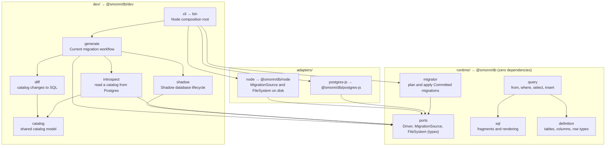
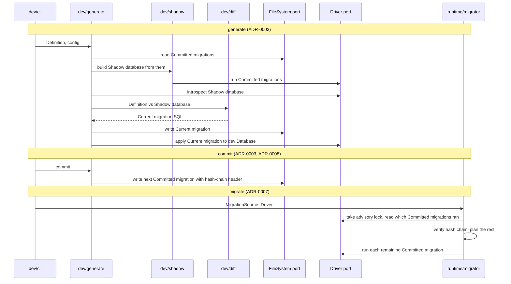

# Architecture

How the source is laid out for v0.1 and which imports are allowed. The reasons are in [ADR-0006](adr/0006-zero-dependency-runtime.md) and [ADR-0009](adr/0009-module-layout-and-ports.md).

## Module map

`src/` has three groups, one per future package. Each module is a folder with an `index.ts` holding only its public API. Tests sit next to the file they cover (`driver.ts` and `driver.test.ts`).

The arrows show the main dependencies, not every one.

### Ports

| Port | Used by | v0.1 adapter |
| --- | --- | --- |
| Driver | migrator, introspect, shadow, generate, and running statements built with `query` | `postgres-js` (wraps postgres.js; `pg` comes later) |
| MigrationSource | migrator (read-only, so migrations can be bundled or in memory) | `node` |
| FileSystem | generate and commit (read, write, list, mkdir) | `node` |

All port types live in `runtime/ports` as type-only exports, so adapters depend on `runtime/` alone. Logger, Codec, Clock, and randomness will become ports after v0.1. Hashing uses a small `sha256` helper over the Web Crypto global rather than a port; ADR-0009 says why.

## Migration flow

Which modules and ports each command touches. The steps restate ADR-0003, ADR-0007, and ADR-0008; how the Shadow database is managed, how the diff works, and how the migrator tracks what ran are open questions on the [v0.1 map](https://github.com/smonn/db/issues/3).

## Import rules

Once tooling lands, dependency-cruiser will enforce these as CI errors, and its config will replace this list. They are a starting point and may change.

1. `runtime/` imports nothing outside `runtime/`.
2. `runtime/` imports no npm packages.
3. `adapters/<x>` imports only `runtime/ports` plus its own host package (`postgres`, `node:*`).
4. Adapters never import other adapters or `dev/`.
5. `dev/` may import `runtime/` but never `adapters/`, except `dev/cli`, the Node composition root.
6. `node:*` imports appear only in `adapters/` and `dev/cli`.
7. Cross-module imports go through the module's `index.ts`.
8. No cycles.
9. Non-test code never imports `*.test.ts` files or test helpers.

Oxlint will cover what dependency-cruiser can't:

- `eslint/no-restricted-globals` bans `process`, `Buffer`, and `__dirname` outside `adapters/` and `dev/cli`. That exemption needs per-path overrides, which are not yet verified in Oxlint.
- `index.ts` holds only named re-exports: no declarations, no `export *`. If no Oxlint rule can express this, a check under `scripts/` does.

oxfmt formats TypeScript and Markdown. knip reports unused files, exports, and dependencies.

## Package entry points

| Entry | Contents |
| --- | --- |
| `@smonn/db` | runtime: sql, definition, query, migrator, port types |
| `@smonn/db/postgres-js` | Driver adapter |
| `@smonn/db/node` | Node MigrationSource and FileSystem adapters |
| `@smonn/db/dev` | catalog, introspect, diff, shadow, generate |
| CLI binary | `dev/cli`, shipped as the package's `bin` |

Each subpath maps to one future package, so a split renames imports one-to-one.
