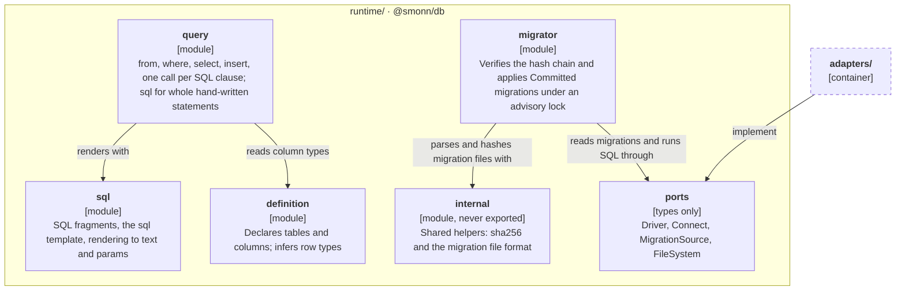
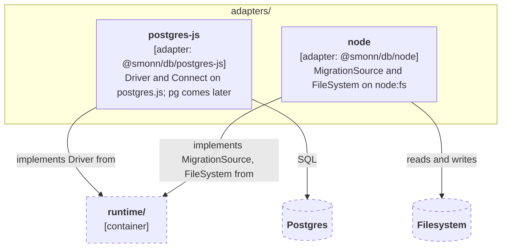
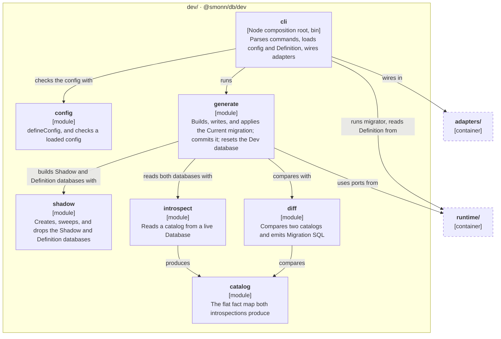
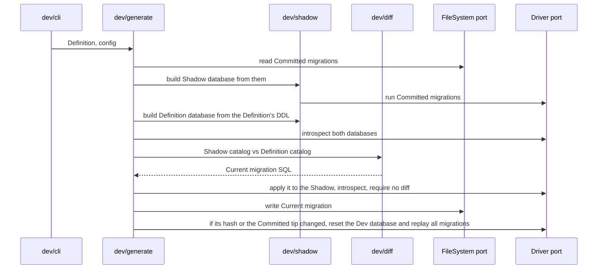
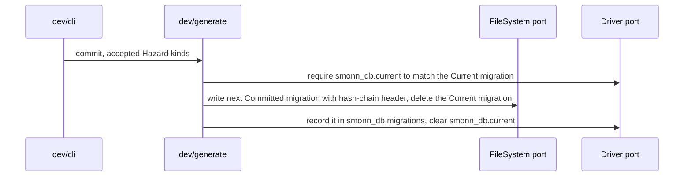
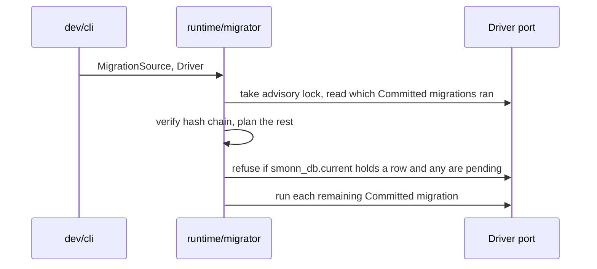
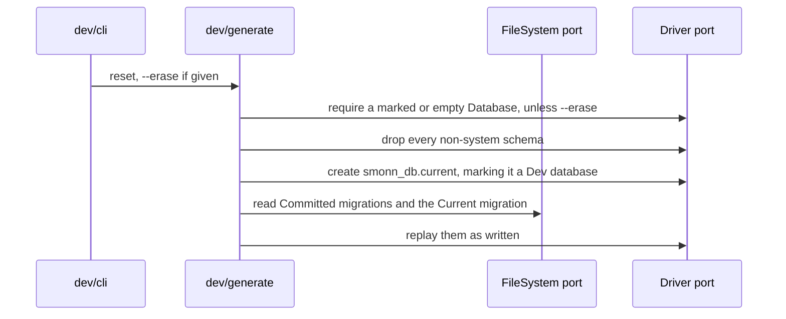

# Architecture

How the source is laid out for v0.1 and which imports are allowed. The reasons are in [ADR-0006](adr/0006-zero-dependency-runtime.md) and [ADR-0009](adr/0009-module-layout-and-ports.md).

## Module map

`src/` has three groups, one per future package. Each module is a folder with an `index.ts` holding only its public API. Tests sit next to the file they cover (`driver.ts` and `driver.test.ts`).

The diagrams follow the [C4 model](https://c4model.com/). The container diagram shows how the groups relate to each other and to the outside world. Each component diagram zooms into one group; an arrow leaving the group points at the other group as a whole. Dashed boxes are outside the group being shown. The arrows show the main dependencies, not every one.

### Containers


### runtime/ components



### adapters/ components



### dev/ components



### Ports

| Port            | Used by                                                                           | v0.1 adapter                                        |
| --------------- | --------------------------------------------------------------------------------- | --------------------------------------------------- |
| Driver          | migrator, introspect, shadow, generate, and running statements built with `query` | `postgres-js` (wraps postgres.js; `pg` comes later) |
| Connect         | shadow, to open the Shadow and Definition databases on the Dev database's server  | `postgres-js`                                       |
| MigrationSource | migrator (read-only, so migrations can be bundled or in memory)                   | `node`                                              |
| FileSystem      | generate and commit (read, write, list, mkdir, remove)                            | `node`                                              |

All port types live in `runtime/ports` as type-only exports, so adapters depend on `runtime/` alone. Logger, Codec, Clock, and randomness will become ports after v0.1. Hashing uses a small `sha256` helper over the Web Crypto global rather than a port; ADR-0009 says why. It lives in `runtime/internal`, which holds shared helpers that are never public API.

## Migration flow

Which modules and ports each command touches. Each diagram restates the ADRs under its heading; [Diff engine](#diff-engine) covers the diff itself and [CLI](#cli) each command's rules.

### generate

Restates ADR-0003, ADR-0011, ADR-0013, and ADR-0016.



### commit

Restates ADR-0003, ADR-0008, and ADR-0015.



### migrate

Restates ADR-0007 and ADR-0016.



### reset

Restates ADR-0016.



## CLI

The `smonndb` binary (a working name) and its config for v0.1. ADR-0014, ADR-0015, and ADR-0016 give the reasons; the rest can change without an ADR.

### Config

`smonndb.config.ts` in the working directory describes one Database, and `--config <path>` picks another. The CLI loads it with a plain `import()`, so it and the Definition use erasable TypeScript only (ADR-0014). `definition` and `migrations` resolve against the config file's folder, and the Definition file's default export is `defineDatabase(...)` (ADR-0010).

```ts
export default defineConfig({
  definition: "./db/definition.ts",
  migrations: "./db/migrations",
  url: process.env.DATABASE_URL,
  trackingSchema: "smonn_db", // optional, the default
});
```

### Commands

| Command         | What it does                                                                                                                                                                                                                                                                                                                                         |
| --------------- | ---------------------------------------------------------------------------------------------------------------------------------------------------------------------------------------------------------------------------------------------------------------------------------------------------------------------------------------------------- |
| `generate`      | Writes `<migrations>/current.sql`, or deletes it when there is no diff, then catches up the Dev database, refusing to reset an unmarked Database (ADR-0016). A hand-edited file is kept and replayed as written, and generate prints the diff to what it would have generated.                                                                       |
| `commit <slug>` | Freezes `current.sql` into `<next>-<slug>.sql`. The slug is kebab-case. Refuses with no `current.sql`, when dev hasn't replayed the file, or for any Hazard kind missing from `--accept <kind,...>`. It runs no shadow replay, since dev just replayed the same file, and records the new file and clears `smonn_db.current` in one dev transaction. |
| `migrate`       | Runs the runtime migrator against `url`. The migrator refuses when `smonn_db.current` holds a row and Committed migrations are pending (ADR-0016).                                                                                                                                                                                                   |
| `reset`         | Drops the extensions that live outside `pg_catalog` or own a schema, and every non-system schema, then replays the Committed migrations and `current.sql` as written, without regenerating. `--erase` lets it run on an unmarked Database (ADR-0016).                                                                                                |
| `verify`        | Checks the hash chain of the Committed migration files offline, with no database.                                                                                                                                                                                                                                                                    |

Every command takes `--config`. Arguments are parsed with `util.parseArgs`. There is no `--url` flag: point a command at another Database through the environment the config reads. Watch mode waits for v0.4.

### Hand edits

Generate writes `--! Generated: sha256:<hex>` over the body it produced. A body that no longer matches counts as hand-edited, and generate stops overwriting it (ADR-0003): it keeps the file, replays it as written, and prints the lines that differ from what it would have generated. Deleting `current.sql` resumes generation. Commit replaces the header with ADR-0008's Previous and Hash headers.

### Concurrency

`generate`, `commit`, and `reset` share a `pg_try_advisory_lock` on the Dev database under a key distinct from the migrator's, and a second run exits at once with an error naming the lock. A waiting run would only redo the first run's reset.

### Output

Plain text: results to stdout, errors to stderr, with no colors when stdout isn't a TTY. Generate prints the file it wrote, each Hazard with its statement, and whether it reset the Dev database. Exit codes are 0 on success, 1 on any refusal or failure, and 2 on a usage error. `--json` waits until after v0.1.

## Diff engine

How generate turns the Definition into the Current migration. ADR-0005 and ADR-0013 give the reasons; the rest is v0.1 design that can change without an ADR.

### What v0.1 models

Schemas, tables, columns (type, NOT NULL, default, identity), single and composite primary keys, and single-column unique constraints: exactly what the Definition can express. Foreign keys, indexes, and multi-column unique wait for v0.2. Both introspections skip the Tracking schema (`smonn_db` unless configured), `pg_catalog`, `information_schema`, `pg_toast*`, `pg_temp*`, extension members, and every kind outside this list (ADR-0005). Generate refuses a Definition that names one of these schemas, since its tables would vanish from the diff.

### Pipeline

1. The Definition converts to a catalog, spelling each type as `format_type` does, and the diff renders it against the catalog of the freshly created Definition database, which holds only template0's `public` schema. That SQL builds the Definition database.
2. `introspect` reads each database in one `REPEATABLE READ READ ONLY` transaction with `search_path` pinned to `pg_catalog`, keyed by name, never by OID.
3. `diff` compares the two catalogs, turns the differences into actions, orders them, and emits SQL.
4. Generate verifies the SQL in the Shadow (ADR-0013), then writes the Current migration.

### Catalog

A flat `Map<key, fact>`. A key is the chain of names from the schema down (`public`, `users`, `email`), joined with `\0`, which no Postgres name can hold, so a table named `users.email` keys apart from the column `email` on `users`. Only the catalog module builds keys: `definitionCatalog` and `introspect` add facts through its builder, and `diff` finds parents, children, and names through its lookups. Each fact carries its parent's key and a plain-data payload compared by deep equality. A default, a primary key, and a unique constraint are separate facts, so one changed default is one difference. Payloads leave out the fact's own name, so renames can be added later. A column's type is the spelling `format_type` gives (`character varying(20)`, `timestamp with time zone`), so `definitionCatalog` rewrites the Definition's `varchar(20)` and `timestamptz` to match what `introspect` reads. NOT NULL is a column attribute; Postgres 18's `pg_constraint` NOT NULL rows are folded into it through `attnotnull`, so a constraint's name never reaches the catalog. A default is a child fact named `default` whose payload is the expression as `pg_get_expr` renders it and whether it calls a volatile function, and an identity is a child fact named `identity` whose payload is `always` or `by default`. Generated columns carry neither, and identity sequence options are not modeled. A primary key and a single-column unique constraint are child facts of the table, named by their constraint, since a drop must say which one; a rename is a drop and an add. The key puts an empty segment before the name (`public\0users\0\0users_pkey`), which no Postgres name can be, so a constraint never keys like a column of the same name. A primary key's payload lists its columns in key order and a unique constraint's names its one column; `introspect` reads no other unique constraint. It also skips a primary key or unique constraint that is `DEFERRABLE`, `NULLS NOT DISTINCT`, has `INCLUDE` columns, or (primary key) `WITHOUT OVERLAPS`: each reads like a plain key but changes what the key means, so each is an Unmodeled object (ADR-0005). Postgres makes primary key columns NOT NULL, so a catalog that names a primary key must mark those columns NOT NULL, as `introspect` reads them.

### Ordering

Each action is one statement-sized change, such as create table, add column, or set default. One `order(actions)` function sorts them in fixed phases: drops of unique constraints, primary keys, columns, tables, and schemas; then creates of schemas, tables, and columns; then column alters (drop default, drop identity, type, NOT NULL, set default, add identity); then adds of primary keys and unique constraints. Within a phase, ties keep catalog order, which `introspect` sorts by name for schemas, tables, and constraints and by position for columns, so new columns follow the Definition. Drops, including the drop half of a changed primary key or unique constraint, follow the source catalog and everything else the target catalog. Dropping a table or column drops what it holds, so no separate drop is emitted for its children. A schema drop without `CASCADE` refuses while the schema holds anything, so each of its tables drops first, without its children. A type change drops the old default first, because Postgres refuses to retype a column whose default can't be cast and otherwise keeps the default cast to the old type, and sets it again afterward. No v0.1 kind references another table, so phases are always correct. When foreign keys land, `order` becomes a topological sort over dependency edges, and nothing else changes.

### SQL rules

- Never `CASCADE` (ADR-0013).
- A default renders in parentheses (`default (now())`), so any expression the Definition writes parses.
- A column's identity is added or dropped, never changed: switching between `always` and `by default` is a hand edit.
- Unique constraints are added with `ALTER TABLE ... ADD CONSTRAINT`, not inline, because `CREATE TABLE` silently drops an inline unique that duplicates the primary key.
- A new column appends; column order differences are ignored, since Postgres can't reorder columns.
- A type change is a plain `ALTER COLUMN ... TYPE` with no `USING`. When a cast is needed, edit the Current migration by hand.
- Renaming a Definition key drops and creates, flagged as data loss (ADR-0010).

### Hazards

Each action kind declares its Hazards (`data_loss`, `rewrite`, `access_exclusive_lock`) in a table, classified from the catalog, not the SQL text. Each Hazard is written as a `-- hazard: <kind>` comment above its statement, and generate returns them with their statements. Generation never blocks on a Hazard; commit does, per kind (ADR-0015).

- `data_loss`: a dropped column or table (so a rename too, ADR-0010), and a type change that converts values without an error but not back, such as `numeric(10,2)` to `integer`, `timestamptz` to `date`, or `double precision` to `real`. A change that fails on a value that doesn't fit, such as `bigint` to `integer`, loses nothing, since the statement rolls back.
- `rewrite`: a type change Postgres can't make in place, and a new column whose default calls a volatile function or that is an identity, because each row needs its own value. In place are only `varchar(n)` to a longer `varchar(m)`, `varchar`, or `text`, `text` to `varchar`, and `numeric(p,s)` to `numeric(q,s)` with `q >= p` or to unbounded `numeric`. `timestamp` and `timestamptz` skip the rewrite only in a UTC session, which a migration can't count on, so they count as a rewrite. A default is volatile when its expression calls a function that `pg_proc` marks volatile, which `introspect` reads by function name, since `pg_depend` omits built-in functions.
- `access_exclusive_lock`: a statement that holds the lock while it does work that grows with the table. Every `ALTER TABLE` takes that lock, but only a rewrite (which therefore carries both kinds), `SET NOT NULL` (a scan of every row), and adding a primary key or unique constraint (an index build) hold it past a catalog change. Adding a key to a table created in the same migration is empty, so it carries nothing.

A type v0.1 doesn't classify carries every Hazard, since only the gate can say it is safe.

### Dev database catch-up

Generate resets the Dev database whenever the Current migration's hash differs from `smonn_db.current`, or the last hash in `smonn_db.migrations` differs from the tip of the Committed migration files. A reset drops the extensions that live outside `pg_catalog` or own a schema, then every non-system schema, recreates `public` as template0 ships it so the Dev database starts where the Shadow does, then replays the Committed migrations and the Current migration, and runs only in a marked or empty Database (ADR-0016). The tip check covers a pulled Committed migration that leaves the regenerated Current migration byte-identical. Resetting is exact after hand edits and branch switches, at the cost of dev data. Keeping that data is a v0.4 dev loop question.

### Postgres versions

v0.1 supports Postgres 18 and newer, and CI runs 18 and, once released, 19. `introspect` reads `server_version_num`, refuses an older server with an error naming the minimum, and branches in TypeScript when a catalog differs between versions.

## Import rules

The layer map is design intent: when code breaks it, fix the code, and change the map only with the design.

| Layer       | Paths                    | May import                                         | Bans                                         |
| ----------- | ------------------------ | -------------------------------------------------- | -------------------------------------------- |
| runtime     | `src/runtime/`           | only itself, no npm packages                       | `node:*`; `process`, `Buffer`, `__dirname`   |
| adapters    | `src/adapters/<name>/`   | `runtime/ports`, `runtime/internal`, its own files | npm packages but its host (`postgres`)       |
| dev         | `src/dev/` but `dev/cli` | `runtime/`, other `dev/` modules                   | `adapters/`; `node:*`; Node globals as above |
| composition | `src/dev/cli/`           | everything above                                   | nothing                                      |

Each folder under a group is a module: its `index.ts` is its only entry point, and any other module imports it through that file. To add a module, create the folder with an `index.ts` of named re-exports, then run `pnpm check`. The rules match folders by pattern, so a new module needs no config change.

CI enforces the module boundaries:

- `scripts/check-imports.ts` holds the dependency-cruiser rules, each with a one-line comment: `runtime/` stays self-contained and free of npm packages, an adapter imports only `runtime/ports`, `runtime/internal`, and its host package, only `dev/cli` wires in adapters, `node:*` stays in host code, cross-module imports go through `index.ts`, no other module's `index.ts` re-exports `runtime/internal`, no cycles, and only tests import `*.test.ts` files, `*.test-helper.ts` helpers, and `vitest`. Tests in any group may import `adapters/postgres-js/test-database.test-helper.ts`, which the group, adapter, and `index.ts` rules otherwise forbid. It fails when it scans 0 modules.
- `.oxlintrc.json` bans the `process`, `Buffer`, and `__dirname` globals in `src/` outside `adapters/` and `dev/cli`.
- `scripts/check-index-exports.ts` keeps each `index.ts` to named re-exports: no declarations, no `export *`.

oxfmt formats TypeScript and Markdown. knip reports unused files, exports, and dependencies.

### Checks and baselines

`pnpm check` runs every gate and the tests; `pnpm check:static` runs every gate but the tests. Each gate is also its own script: `format:check`, `check:docs`, `check:mermaid`, `typecheck`, `lint`, `lint:actions`, `check:imports`, `check:index`, `knip`, `deps` (rev-dep duplicated-code detection), `fta` (file maintainability), and `coverage`.

Baselines recorded at adoption (2026-10-22), each lowered as code improves and never raised without the maintainer:

- `complexity` starts at 21 (`dev/diff/hazards.ts`), target 6, in `.oxlintrc.json`. `max-params` and `max-depth` are at their target of 4.
- Every TypeScript strictness flag is on, so the compiler has no baseline.

## Package entry points

| Entry                   | Contents                                              |
| ----------------------- | ----------------------------------------------------- |
| `@smonn/db`             | runtime: sql, definition, query, migrator, port types |
| `@smonn/db/postgres-js` | Driver adapter                                        |
| `@smonn/db/node`        | Node MigrationSource and FileSystem adapters          |
| `@smonn/db/dev`         | config, catalog, introspect, diff, shadow, generate   |
| CLI binary              | `dev/cli`, shipped as the package's `bin`             |

Each subpath maps to one future package, so a split renames imports one-to-one.
