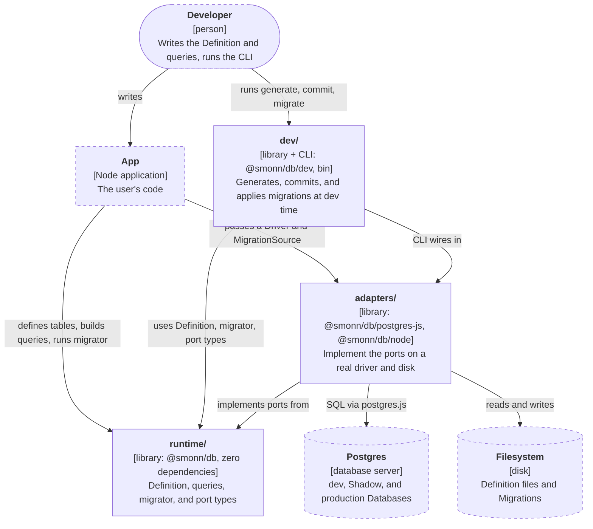
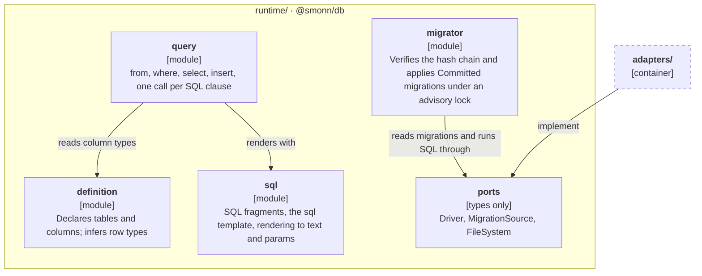
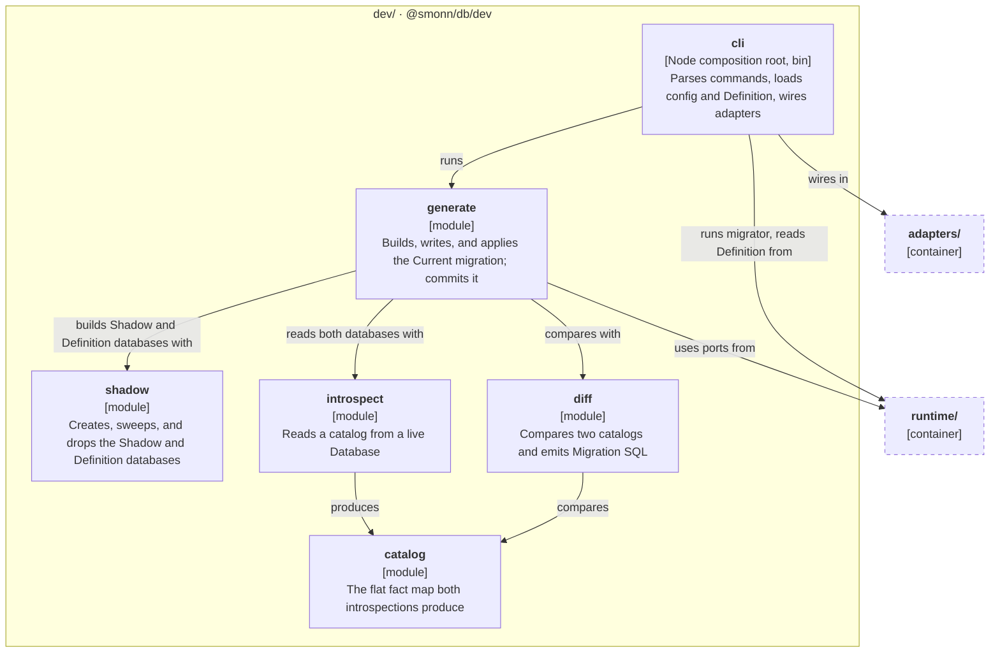
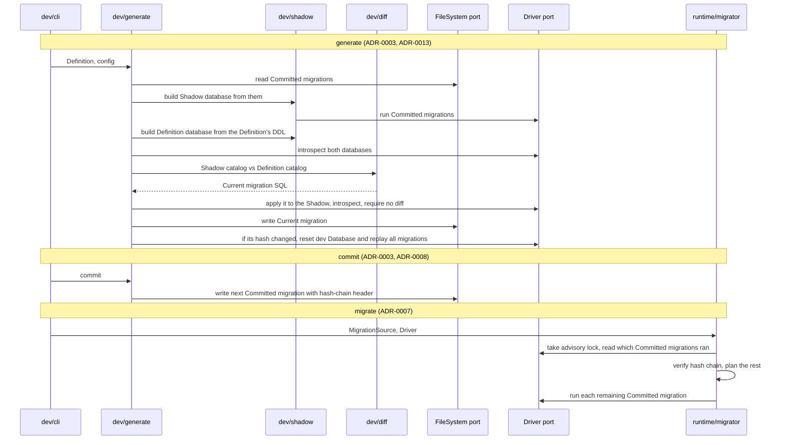

# Architecture

How the source is laid out for v0.1 and which imports are allowed. The reasons are in [ADR-0006](adr/0006-zero-dependency-runtime.md) and [ADR-0009](adr/0009-module-layout-and-ports.md).

## Module map

`src/` has three groups, one per future package. Each module is a folder with an `index.ts` holding only its public API. Tests sit next to the file they cover (`driver.ts` and `driver.test.ts`).

The diagrams follow the [C4 model](https://c4model.com/). The container diagram shows how the groups relate to each other and to the outside world. Each component diagram zooms into one group; an arrow leaving the group points at the other group as a whole. Dashed boxes are outside the group being shown. The arrows show the main dependencies, not every one.

### Containers

### runtime/ components

### adapters/ components

### dev/ components

### Ports

| Port            | Used by                                                                           | v0.1 adapter                                        |
| --------------- | --------------------------------------------------------------------------------- | --------------------------------------------------- |
| Driver          | migrator, introspect, shadow, generate, and running statements built with `query` | `postgres-js` (wraps postgres.js; `pg` comes later) |
| MigrationSource | migrator (read-only, so migrations can be bundled or in memory)                   | `node`                                              |
| FileSystem      | generate and commit (read, write, list, mkdir)                                    | `node`                                              |

All port types live in `runtime/ports` as type-only exports, so adapters depend on `runtime/` alone. Logger, Codec, Clock, and randomness will become ports after v0.1. Hashing uses a small `sha256` helper over the Web Crypto global rather than a port; ADR-0009 says why.

## Migration flow

Which modules and ports each command touches. The steps restate ADR-0003, ADR-0007, ADR-0008, ADR-0011, and ADR-0013; [Diff engine](#diff-engine) covers the diff itself.

## Diff engine

How generate turns the Definition into the Current migration. ADR-0005 and ADR-0013 give the reasons; the rest is v0.1 design that can change without an ADR.

### What v0.1 models

Schemas, tables, columns (type, NOT NULL, default, identity), single and composite primary keys, and single-column unique constraints: exactly what the Definition can express. Foreign keys, indexes, and multi-column unique wait for v0.2. Both introspections skip the migrator's tracking schema (`smonn_db` unless configured), `pg_catalog`, `information_schema`, `pg_toast*`, `pg_temp*`, extension members, and every kind outside this list (ADR-0005).

### Pipeline

1. The Definition converts to a catalog as written, and the diff renders it against an empty catalog. That SQL builds the Definition database.
2. `introspect` reads each database in one `REPEATABLE READ READ ONLY` transaction with `search_path` pinned to `pg_catalog`, keyed by name, never by OID.
3. `diff` compares the two catalogs, turns the differences into actions, orders them, and emits SQL.
4. Generate verifies the SQL in the Shadow (ADR-0013), then writes the Current migration.

### Catalog

A flat `Map<path, fact>`. A path is the dotted chain of names from the schema down (`public.users.email`, `public.users.email.default`), and each fact carries its parent's path and a plain-data payload compared by deep equality. A default, a primary key, and a unique constraint are separate facts, so one changed default is one difference. Payloads leave out the fact's own name, so renames can be added later. NOT NULL is a column attribute; Postgres 18's `pg_constraint` NOT NULL rows are folded into it.

### Ordering

Each action is one statement-sized change, such as create table, add column, or set default. One `order(actions)` function sorts them in fixed phases: drops of unique constraints, primary keys, columns, tables, and schemas; then creates of schemas, tables, and columns; then column alters (drop default, type, NOT NULL, set default, identity); then adds of primary keys and unique constraints. Ties are broken by path. Dropping a table or schema drops what it contains, so no separate drop is emitted for its children. A type change drops the old default first, because Postgres refuses to retype a column whose default can't be cast, and sets it again afterward. No v0.1 kind references another table, so phases are always correct. When foreign keys land, `order` becomes a topological sort over dependency edges, and nothing else changes.

### SQL rules

- Never `CASCADE` (ADR-0013).
- Unique constraints are added with `ALTER TABLE ... ADD CONSTRAINT`, not inline, because `CREATE TABLE` silently drops an inline unique that duplicates the primary key.
- A new column appends; column order differences are ignored, since Postgres can't reorder columns.
- A type change is a plain `ALTER COLUMN ... TYPE` with no `USING`. When a cast is needed, edit the Current migration by hand.
- Renaming a Definition key drops and creates, flagged as data loss (ADR-0010).

### Hazards

Each action kind declares its hazards (`data_loss`, `rewrite`, `access_exclusive_lock`) in a table, classified from the catalog, not the SQL text. Each hazard is written as a `-- hazard: <kind>` comment above its statement. Generation never blocks on a hazard. Whether commit blocks one, and a possible strict mode, are for [Config file and CLI for v0.1](https://github.com/smonn/db/issues/11) to decide.

### Dev Database catch-up

Whenever the Current migration's hash differs from `smonn_db.current`, generate resets the dev Database: it drops every non-system schema, then replays the Committed migrations and the Current migration. Resetting is exact after hand edits and branch switches, at the cost of dev data. Keeping that data is a v0.4 dev loop question.

### Postgres versions

v0.1 supports Postgres 18 and newer, and CI runs 18 and, once released, 19. `introspect` reads `server_version_num`, refuses an older server with an error naming the minimum, and branches in TypeScript when a catalog differs between versions.

## Import rules

Once tooling lands, dependency-cruiser will enforce these as CI errors, and its config will replace this list. They are a starting point and may change.

1. `runtime/` imports nothing outside `runtime/`.
2. `runtime/` imports no npm packages.
3. `adapters/<x>` imports only `runtime/ports` plus its own host package (`postgres`, `node:*`).
4. Adapters never import other adapters or `dev/`.
5. `dev/` may import `runtime/` but never `adapters/`, except `dev/cli`, the Node composition root.
6. `node:*` imports appear only in `adapters/` and `dev/cli`.
7. Cross-module imports go through the module's `index.ts`.
8. No cycles.
9. Non-test code never imports `*.test.ts` files or test helpers.

Oxlint will cover what dependency-cruiser can't:

- `eslint/no-restricted-globals` bans `process`, `Buffer`, and `__dirname` outside `adapters/` and `dev/cli`. That exemption needs per-path overrides, which are not yet verified in Oxlint.
- `index.ts` holds only named re-exports: no declarations, no `export *`. If no Oxlint rule can express this, a check under `scripts/` does.

oxfmt formats TypeScript and Markdown. knip reports unused files, exports, and dependencies.

## Package entry points

| Entry                   | Contents                                              |
| ----------------------- | ----------------------------------------------------- |
| `@smonn/db`             | runtime: sql, definition, query, migrator, port types |
| `@smonn/db/postgres-js` | Driver adapter                                        |
| `@smonn/db/node`        | Node MigrationSource and FileSystem adapters          |
| `@smonn/db/dev`         | catalog, introspect, diff, shadow, generate           |
| CLI binary              | `dev/cli`, shipped as the package's `bin`             |

Each subpath maps to one future package, so a split renames imports one-to-one.
