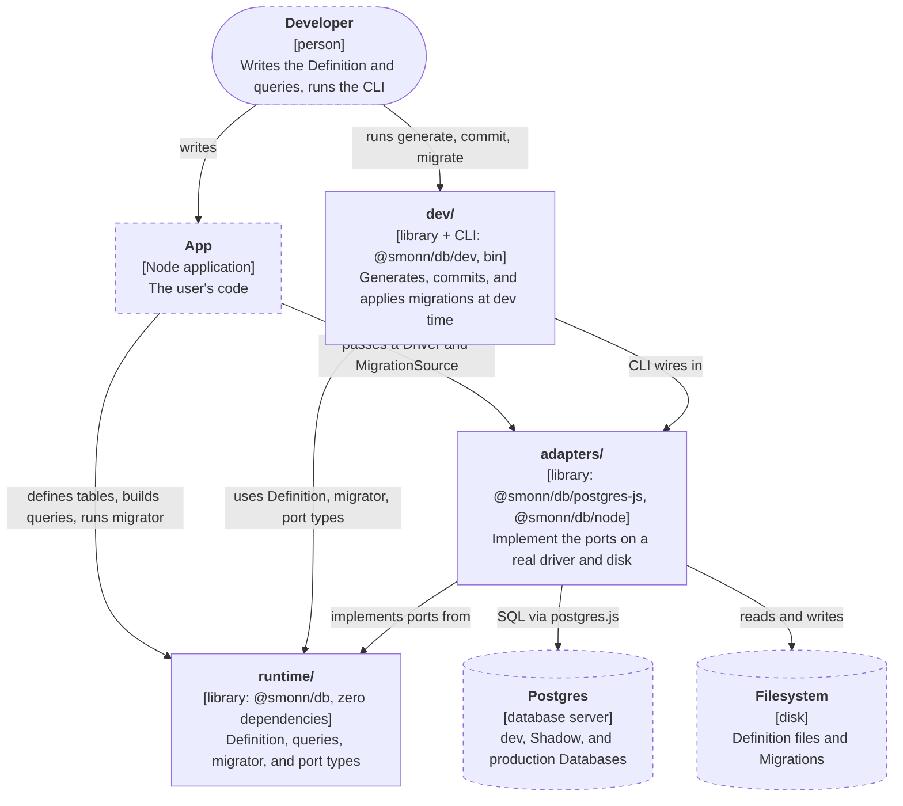
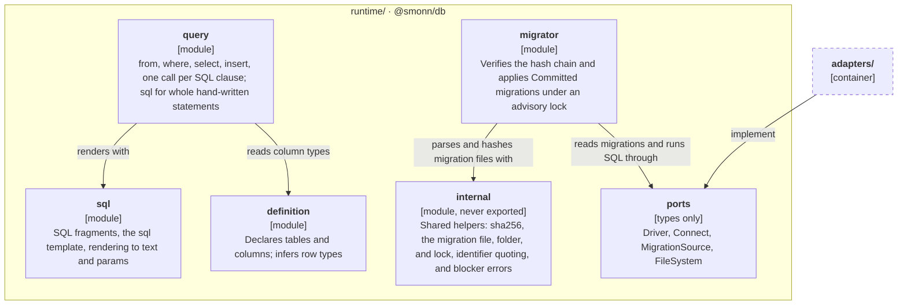
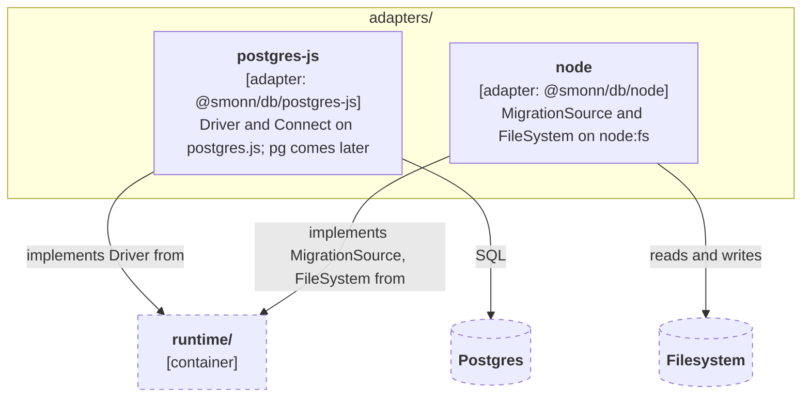
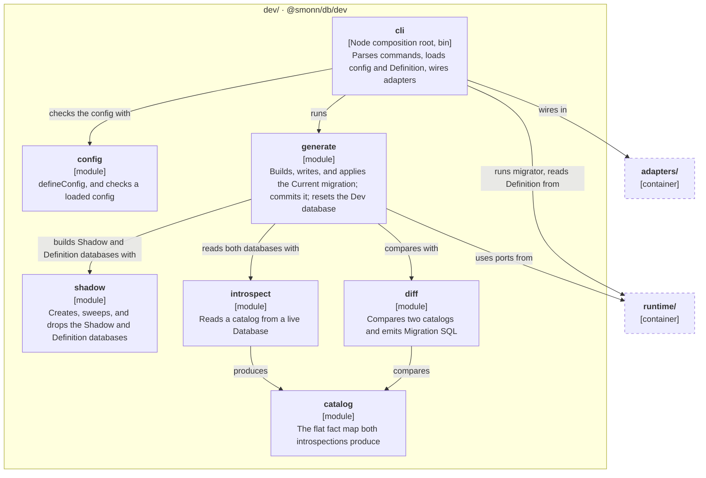

# Architecture

How the source is laid out for v0.1 and which imports are allowed. The reasons are in [ADR-0006](../adr/0006-zero-dependency-runtime.md) and [ADR-0009](../adr/0009-module-layout-and-ports.md).

- [CLI](cli.md): config, output, and for each command the modules and ports it touches and its rules.
- [Diff engine](diff-engine.md): how generate turns the Definition into the Current migration.

These docs hold the shape of the code and the rules that cross modules. Behavior inside one module belongs in its TSDoc and a decision in an ADR. `scripts/check-docs.ts` caps each file's words.

## Module map

`src/` has three groups, one per future package. Each module is a folder with an `index.ts` holding only its public API. Tests sit next to the file they cover (`driver.ts` and `driver.test.ts`).

The diagrams follow the [C4 model](https://c4model.com/). The container diagram shows how the groups relate to each other and to the outside world. Each component diagram zooms into one group; an arrow leaving the group points at the other group as a whole. Dashed boxes are outside the group being shown. The arrows show the main dependencies, not every one.

### Containers

### runtime/ components

### adapters/ components

### dev/ components

### Ports

| Port            | Used by                                                                           | v0.1 adapter                                        |
| --------------- | --------------------------------------------------------------------------------- | --------------------------------------------------- |
| Driver          | migrator, introspect, shadow, generate, and running statements built with `query` | `postgres-js` (wraps postgres.js; `pg` comes later) |
| Connect         | shadow, to open the Shadow and Definition databases on the Dev database's server  | `postgres-js`                                       |
| MigrationSource | migrator (read-only, so migrations can be bundled or in memory)                   | `node`                                              |
| FileSystem      | generate, commit, and rebase (read, write, list, mkdir, remove, rename)           | `node`                                              |

All port types live in `runtime/ports` as type-only exports, so adapters depend on `runtime/` alone. Logger, Clock, and randomness will become ports after v0.1. A Codec is not a port: the query layer applies it, and no adapter supplies one (ADR-0022). Hashing uses a small `sha256` helper over the Web Crypto global rather than a port; ADR-0009 says why. It lives in `runtime/internal`, which holds shared helpers that are never public API.

## Import rules

The layer map is design intent: when code breaks it, fix the code, and change the map only with the design.

| Layer       | Paths                    | May import                                         | Bans                                         |
| ----------- | ------------------------ | -------------------------------------------------- | -------------------------------------------- |
| runtime     | `src/runtime/`           | only itself, no npm packages                       | `node:*`; `process`, `Buffer`, `__dirname`   |
| adapters    | `src/adapters/<name>/`   | `runtime/ports`, `runtime/internal`, its own files | npm packages but its host (`postgres`)       |
| dev         | `src/dev/` but `dev/cli` | `runtime/`, other `dev/` modules                   | `adapters/`; `node:*`; Node globals as above |
| composition | `src/dev/cli/`           | everything above                                   | nothing                                      |

Each folder under a group is a module: its `index.ts` is its only entry point, and any other module imports it through that file. To add a module, create the folder with an `index.ts` of named re-exports, then run `pnpm check`. The rules match folders by pattern, so a new module needs no config change.

CI enforces the boundaries. `scripts/check-imports.ts` holds the dependency-cruiser rules, each with a comment saying what it guards; `.oxlintrc.json` bans the Node globals; and `scripts/check-index-exports.ts` keeps each `index.ts` to named re-exports and checks what the group indexes export.

## Package entry points

| Entry                   | Source                              | Contents                                              |
| ----------------------- | ----------------------------------- | ----------------------------------------------------- |
| `@smonn/db`             | `src/runtime/index.ts`              | runtime: sql, definition, query, migrator, port types |
| `@smonn/db/postgres-js` | `src/adapters/postgres-js/index.ts` | Driver adapter                                        |
| `@smonn/db/node`        | `src/adapters/node/index.ts`        | Node MigrationSource and FileSystem adapters          |
| `@smonn/db/dev`         | `src/dev/index.ts`                  | config, catalog, introspect, diff, shadow, generate   |
| `smonndb` bin           | `src/dev/cli/bin.ts`                | the CLI, shipped as the package's `bin`               |

Each subpath maps to one future package, so a split renames imports one-to-one. `src/runtime/index.ts` and `src/dev/index.ts` list the package's public API by hand, picked from their group's module indexes, and no `src/` file imports them. A module index also serves imports between modules, so a name there is not public until a group index lists it.

tsdown builds every entry in one pass (`pnpm build`, which `prepack` runs before `pnpm pack`), so modules shared between entries land in shared chunks and load once. It also writes the `exports` and `bin` fields of `package.json` from `tsdown.config.ts`: add an entry there, build, and commit the rewritten `package.json`. `src/dev/cli/package.test.ts` packs the tarball, installs it in a temp project, imports and type-checks each entry, runs the bin, and fails when the build changed `package.json`.
