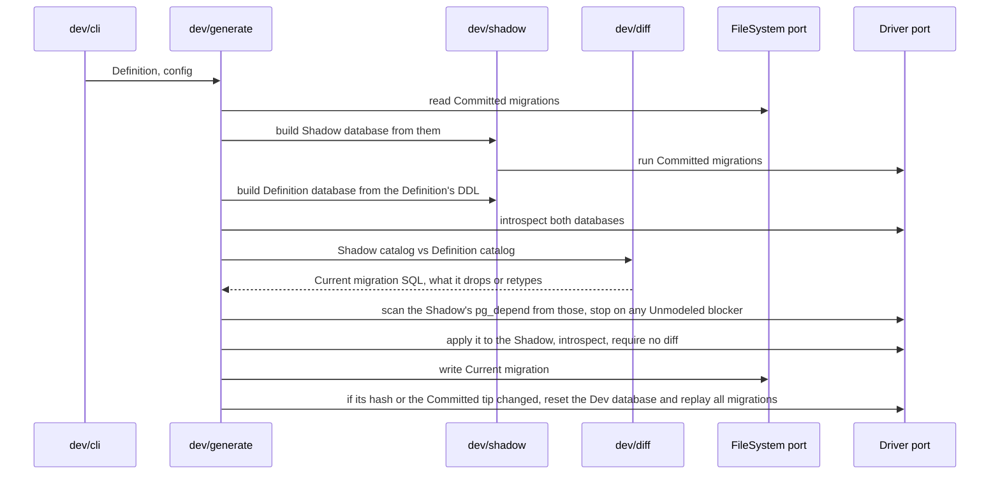
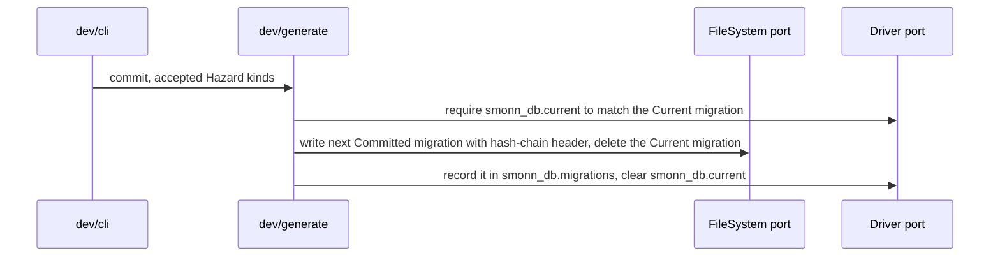
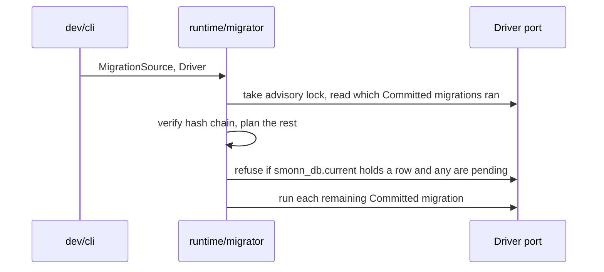
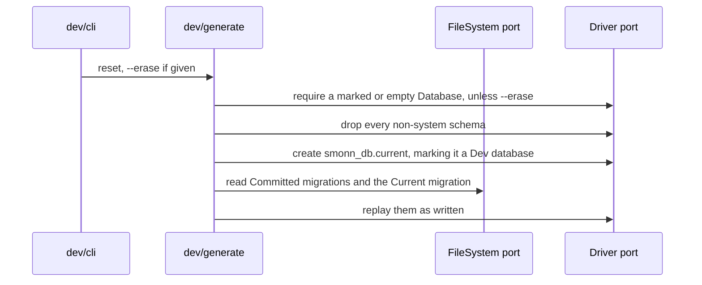
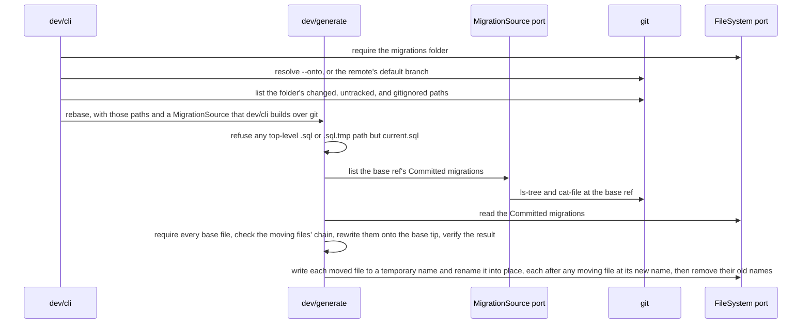

# CLI

The `smonndb` binary (a working name), its config, and which modules and ports each command touches. ADR-0014, ADR-0015, and ADR-0016 give the reasons; the rest can change without an ADR. Each diagram restates the ADRs its section cites. [Diff engine](diff-engine.md) covers how generate builds the SQL.

## Config

`smonndb.config.ts` in the working directory describes one Database, and `--config <path>` picks another. The CLI loads it with a plain `import()`, so it and the Definition use erasable TypeScript only (ADR-0014). `definition` and `migrations` resolve against the config file's folder, and the Definition file's default export is `defineDatabase(...)` (ADR-0010).

```ts
export default defineConfig({
  definition: "./db/definition.ts",
  migrations: "./db/migrations",
  url: process.env.DATABASE_URL,
  trackingSchema: "smonn_db", // optional, the default
});
```

Every command takes `--config`, and `util.parseArgs` parses the arguments. There is no `--url` flag: point a command at another Database through the environment the config reads. Watch mode waits for v0.4.

## Output

Plain text: results to stdout, errors to stderr, with no colors when stdout isn't a TTY. Exit codes are 0 on success, 1 on any refusal or failure, and 2 on a usage error. `--json` waits until after v0.1.

## generate

ADR-0003, ADR-0011, ADR-0013, ADR-0016, and ADR-0025.



Generate writes `<migrations>/current.sql`, or deletes it when there is no diff, then catches up the Dev database. It prints the file it wrote, each Hazard with its statement, and whether it reset the Dev database.

### Hand edits

Generate writes `--! Generated: sha256:<hex>` over the body it produced. A body that no longer matches counts as hand-edited, and generate stops overwriting it (ADR-0003): it keeps the file, replays it as written, and prints the lines that differ from what it would have generated. It runs the edit in the Shadow instead of the generated body, so a SQL error fails the run before the Dev database is touched, and a leftover difference from the Definition prints as a warning (ADR-0013). Deleting `current.sql` resumes generation.

### Dev database catch-up

Generate resets the Dev database, as [`reset`](#reset) does and only in a marked or empty Database (ADR-0016), whenever the Current migration's hash differs from `smonn_db.current`, or the last hash in `smonn_db.migrations` differs from the tip of the Committed migration files. The tip check covers a pulled Committed migration that leaves the regenerated Current migration byte-identical. Resetting is exact after hand edits and branch switches, at the cost of dev data. Keeping that data is a v0.4 dev loop question.

## commit

ADR-0003, ADR-0008, and ADR-0015.



`commit <slug>` freezes `current.sql` into `<next>-<slug>.sql`, with a kebab-case slug, and replaces the Generated header with ADR-0008's Previous and Hash headers. It refuses with no `current.sql`, when dev hasn't replayed the file, for any Hazard kind missing from `--accept <kind,...>`, or for a near-miss Hazard comment ([Hazards](diff-engine.md#hazards)). It runs no Shadow replay, because the user decides when dev resets, and the `smonn_db.current` check already shows dev replayed this same file. It records the new file and clears `smonn_db.current` in one dev transaction.

## migrate

ADR-0007, ADR-0016, and ADR-0025.



`migrate` runs the runtime migrator against `url`. When an object outside the Definition blocks a drop or retype (`2BP01`, `0A000`), the error names the file and its blockers, through the mapping in `runtime/internal` that generate's Shadow check shares.

## reset

ADR-0016.



`reset` drops the extensions that live outside `pg_catalog` or own a schema, then every non-system schema. It recreates `public` as template0 ships it, so the Dev database starts where the Shadow does, then replays the Committed migrations and `current.sql` as written, without regenerating. `--erase` lets it run on an unmarked, non-empty Database.

## verify

`verify` checks the hash chain of the Committed migration files offline, with no database.

## rebase

ADR-0008.



`rebase` moves the Committed migrations that the base ref lacks onto its tip, rewriting their sequence and headers, offline and with no database. `--onto <ref>` names the ref, by default `refs/remotes/origin/HEAD`. `dev/cli` reads the ref's files with `git ls-tree` and `git cat-file`, and needs git 2.30 or newer for `rev-parse --end-of-options`. It writes nothing and refuses when:

- the folder is missing;
- git shows a changed, untracked, or gitignored top-level `.sql` or `.sql.tmp` file in it other than `current.sql`;
- the base ref's chain is broken;
- the folder lacks a base file, or holds a same-named file with different content;
- a moving file no longer matches its Hash, or the moving files don't chain from a base file;
- the result fails the final verify.

## No-transaction files

A hand edit can open `current.sql` with `--! no-transaction` (ADR-0020) so it holds a statement such as `CREATE INDEX CONCURRENTLY`. Commit carries the header into the Committed file below `--! Hash`, and the chain hash covers it. Such a file holds one statement: Postgres runs a script of several as one implicit transaction and refuses `CONCURRENTLY` in it with 25001, and the migrator relies on that instead of parsing SQL.

`migrate` records the file as `started`, runs it in autocommit, then sets `applied`, or `failed` with Postgres's message, and refuses to run anything while the last row is `started` or `failed`. The Shadow check runs a hand edit without the header inside a transaction, so it fails there as it would in `migrate`, with a hint to add the header.

`reset` commits what it replayed so far, runs the file in autocommit, and replays the rest in a new transaction, so a failure after such a file leaves the Dev database wiped and partly replayed. Generate never emits `CONCURRENTLY` and never splits a diff across files, so changes that need two Committed files take two `commit`s.

## Concurrency

`generate`, `commit`, and `reset` share a `pg_try_advisory_lock` on the Dev database under a key distinct from the migrator's, and a second run exits at once with an error naming the lock. A waiting run would only redo the first run's reset, and failing at once gives quick feedback when several agent sessions share one Dev database. Every reset also takes the migrator's own lock, polled for, so a runtime `migrate` on the Dev database waits for the reset instead of racing its wipe. `generate` holds the migrator's lock from its Dev database check until the run ends, Shadow work included.
